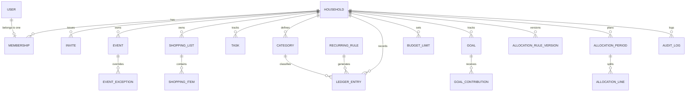

# OurHome — Data model (draft v0.6)

**Status:** draft for review, no code yet. v0.2 applied tasks, secret expenses, emergency fund balance, and the FX snapshot. v0.3 applied shared-by-default expenses, secret expenses counting toward autonomy, income always shared, and a locked base currency. v0.4 removes the two-member threshold: the secret total is always shown, and only per-purchase details are hidden. **v0.5** reverses the FX and base-currency design: the base currency can change at any time, and paid entries are converted with the historical rate of their own date (no stored snapshot). It also makes the admin role single and transferable, limits events to one reminder, adds a configurable lookback window, and confirms optional task assignees. **v0.6** sets the lookback default to 6 months, blocks unsupported currencies (no manual rates), and makes corrected historical FX rates overwrite stored values. No open questions remain.
**Based on:** [plan.md](plan.md) v0.2, [stack.md](stack.md)

## Conventions

- Primary keys: UUID (v7 preferred, time-sortable).
- Every tenant table has `household_id`, plus `created_at`, `created_by`, `updated_at`, `updated_by` unless noted.
- Money: `amount_minor` (bigint, integer minor units) + `currency` (ISO 4217).
- Dates without time (`occurred_on`, `due_on`) are `date`. Event times are `timestamptz` plus an IANA time zone.
- References between tenant tables use composite keys `(household_id, id)` so cross-household links are impossible.
- "Derived" means computed at read time, not stored.

## Overview

`FX_RATE` is global (not tenant-scoped) and is not shown.

---

## 1. Identity and access

### user (managed by Better Auth)
`id`, `email` (unique), `name`, `email_verified`, `created_at`. Plus the auth library's own `session` / `account` / `verification` tables. Not tenant-scoped.

### household
| Field | Notes |
|---|---|
| `id`, `name` | |
| `base_currency` | Currency for all totals. Admin can change it at any time, including after paid entries exist. Changing it triggers no data rewrite: totals are recomputed from original amounts and historical rates. The change is audited. Must be one of the currencies supported by the FX source. |
| `autonomy_target_months` | Nullable; the family sets it, there is no default. |
| `essential_avg_months` | Lookback window (in full months) for the essential-expense average; configurable per household. **Default 6.** If fewer months of history exist, the indicator uses what is available and shows a warning with the months actually used. |
| `include_illiquid_in_fund` | Admin opt-in (default false). |
| `created_at`, `created_by` | |

Allocation percentages live in `allocation_rule_version`, not here, so that their history is preserved.

### membership
One row per user. `user_id` is **unique** (one household per account in the MVP).

| Field | Notes |
|---|---|
| `household_id`, `user_id` | |
| `role` | `admin` or `member`. **Exactly one active admin per household** (partial unique index on `household_id` where `role = 'admin'` and `removed_at` is null). |
| `can_register_finance` | May create income/expense entries. |
| `can_edit_finance` | May edit/delete shared entries created by others. |
| `can_manage_finance_rules` | May manage categories, budgets, goals, allocation rules. |
| `joined_at`, `removed_at` | Soft removal keeps authorship intact. |

The admin implicitly has every permission. Everyone can use calendar, shopping lists, and tasks.

**Admin transfer.** The current admin can hand the role to another active member. The swap happens in one transaction (old admin becomes `member`, new admin becomes `admin`) and is audited. The old admin keeps their existing finance permission flags until changed. The admin cannot leave the household, be removed, or delete their account until the role has been transferred (or the household is deleted).

### invite
| Field | Notes |
|---|---|
| `household_id`, `created_by` | |
| `type` | `email` or `code`. |
| `email` | Only for email invites. |
| `token_hash` | Hash of the emailed token or the shared code; never store plaintext. |
| `role`, `can_*` presets | Applied to the membership on acceptance. |
| `expires_at`, `max_uses` (code: configurable; email: 1), `used_count` | |
| `accepted_by`, `accepted_at`, `revoked_at` | |

Rules: a user who already belongs to a household cannot accept an invite. Rate-limit code attempts.

---

## 2. Calendar

### event
`id`, `household_id`, `title`, `description`, `location`, `starts_at`, `ends_at`, `all_day`, `timezone`, `rrule` (nullable, RFC 5545), `recurrence_until` (nullable), `reminder_offset_minutes` (nullable; **at most one reminder per event**), audit columns.

Occurrences are expanded at read time within the requested window; they are not stored.

### event_exception
Per-occurrence override of a recurring event: `event_id`, `original_start`, `is_cancelled`, and nullable overrides for `title`, `starts_at`, `ends_at`, `description`. Unique on `(event_id, original_start)`.

### Reminders
A reminder is the single `reminder_offset_minutes` on the event (or on an occurrence override, if added later). It is shown in-app: the dashboard lists occurrences whose `start - offset` has passed and whose start is still ahead. No external delivery in the MVP.

Optional: `reminder_dismissal(event_id, user_id, occurrence_start)` so each member can dismiss a reminder per occurrence.

---

## 3. Shopping and tasks

### shopping_list
`id`, `household_id`, `name`, `archived_at`, audit columns.

### shopping_item
| Field | Notes |
|---|---|
| `list_id`, `household_id` | |
| `name` | |
| `quantity` | Numeric, default 1. |
| `is_bought`, `bought_by`, `bought_at` | Bought items stay in the list history. |
| audit columns | |

### task
Minimal task list, shared by the household.

| Field | Notes |
|---|---|
| `household_id`, `title` | |
| `assignee_id` | Nullable; must be a member of the same household. |
| `is_done`, `done_by`, `done_at` | |
| audit columns | |

No due dates, priorities, or subtasks in the MVP.

**Dashboard pending count** = items with `is_bought = false` across non-archived lists + tasks with `is_done = false`.

---

## 4. Finance

### category
`id`, `household_id`, `name`, `kind` (`expense` / `income`), `is_essential` (expense only; feeds autonomy), `archived_at`. Unique `(household_id, kind, name)`.

### ledger_entry
| Field | Notes |
|---|---|
| `household_id`, `id` | |
| `kind` | `income` or `expense`. |
| `status` | `planned` or `paid` for both kinds (the UI may label paid income as "recebido"). |
| `amount_minor`, `currency` | Original amount and currency, always preserved. |
| `occurred_on` | Due date if planned, payment date if paid. |
| `category_id` | |
| `description` | |
| `owner_id` | The member who registered it. |
| `visibility` | `shared` or `secret`. `secret` is allowed only on `kind = expense` (enforced by a check constraint). Default `shared`; the user marks an expense as secret on creation or later. Income is always `shared`. |
| `recurring_rule_id` | Nullable; set for generated entries. |
| `confirmed_by`, `confirmed_at` | Set on planned → paid. |
| audit columns, `deleted_at` | Soft delete so history is preserved. |

**Visibility rules**

- `shared`: readable by the whole household, with all details and authorship.
- `secret`: individual rows, descriptions, categories, and history are readable **only by `owner_id`**. No member, including admins, can list or open them.
- Secret expenses **do count** in household indicators, but only through a dedicated aggregate query that returns a single monthly total of secret expenses in base currency. That query never returns rows, categories, or per-member splits.
- **No minimum number of members.** The aggregate is always returned, even when a single member recorded all the secret expenses. The plan hides purchase details, not the total. Per-member splits are still never exposed, but in a two-person household the total can implicitly be attributed to whoever else is spending. This is accepted.
- Secret expenses always appear in the monthly balance, the surplus, and the total budget, but **not** in category breakdowns or category budgets. They appear as one separate line ("personal expenses").
- **Autonomy.** Secret expenses in essential categories count toward the essential-expense average. Only the resulting average is exposed, never the secret rows.
- Owners can change a single entry between `secret` and `shared` at any time. Switching is audited, and the audit entry is visible only to the owner while the entry is secret.

**Currency conversion rules**

- Converted amounts are **derived at read time**; no converted amount is stored on the entry.
- **`paid` entries** use the historical rate for `occurred_on` (or the latest earlier rate if none exists for that date). Because past daily rates do not change, paid totals stay stable on their own, and they recompute correctly whenever the base currency changes.
- **`planned` entries** and all balances not tied to a paid entry (goal progress, emergency fund balance, planned commitments) use the **current daily rate**.
- When the entry's currency equals the base currency, the rate is 1.
- The UI can show, on demand, the rate and rate date used for any converted figure, to keep indicators explainable.
- Editing a paid entry's date or currency changes its conversion automatically, and the edit is audited like any other.
- If the FX source corrects a past rate, the stored rate is overwritten and every figure derived from it changes (see `fx_rate`).

**Changing the base currency**

- Allowed at any time by the admin, audited (`entity_type = household`).
- All derived totals, balances, and indicators are recomputed with the new base currency.
- Stored base-currency figures need care: budget limits and allocation periods keep their own `currency` (see below) instead of assuming the household base currency.

### recurring_rule
`household_id`, `kind`, `amount_minor`, `currency`, `category_id`, `description`, `owner_id`, `visibility`, `frequency` (`weekly` / `monthly` / `yearly`), `interval`, `start_on`, `end_on` (nullable), `day_of_month` handling for short months, `active`.

A job (and a lazy check on read) materialises `planned` ledger entries for a rolling window (e.g. next 12 months). Unique `(recurring_rule_id, occurred_on)` makes generation idempotent. Editing a rule only updates future `planned` entries, never `paid` ones.

### budget_limit
`household_id`, `category_id` (**null = total monthly limit**), `amount_minor`, `currency` (the currency the limit was set in), `effective_from` (first month). The limit for a month is the latest row with `effective_from` ≤ that month, so changes keep history. Spent and remaining are derived. If the household base currency changes, the limit stays in its own currency and is converted at the current daily rate for display. The admin can later set a new limit directly in the new base currency.

### fx_rate (global)
`rate_date`, `quote_currency`, `rate` (against a single reference currency, EUR if using ECB data), `source`, `fetched_at`, `updated_at`. Unique `(rate_date, quote_currency)`. Cross rates are computed. On weekends or holidays, use the last available earlier date and flag it.

Because paid entries depend on **historical** rates and the base currency can change, the table must hold history for **every supported currency**, not just the current base. A daily job fetches the new day's rates. A backfill step loads earlier dates on demand (for example when an entry is dated before the first stored rate), using a source with historical data such as Frankfurter/ECB. 

**Supported currencies.** Only currencies the source provides rates for can be used. The app blocks creating or editing a ledger entry, recurring rule, goal, budget limit, or base-currency change that uses an unsupported currency. There are no manual rates in the MVP. The currency picker lists only supported codes. If the source drops a currency that is already in use, existing entries keep their stored original currency and the last known rates, and the UI shows a warning.

**Corrections.** The daily job also re-fetches a recent window (for example the last 30 days) and upserts: if the source returns a different rate for a past date, the stored value is **overwritten** and `updated_at` is set. Reports and totals derived from that rate change accordingly. This is accepted. Optionally, keep a small `fx_rate_revision(rate_date, quote_currency, old_rate, new_rate, changed_at)` log so a changed total can be explained.

---

## 5. Goals

### goal
| Field | Notes |
|---|---|
| `household_id`, `name` | |
| `kind` | `emergency_fund`, `savings`, `family`. At most one `emergency_fund` per household. |
| `target_minor`, `currency` | Target is optional. |
| `deadline` | Optional. |
| `counts_toward_fund` | Admin-only explicit inclusion in the emergency fund balance (default false). |
| `status` | `active`, `completed`, `archived`. |
| `completed_at` | |

### goal_contribution
`goal_id`, `household_id`, `amount_minor` (signed), `currency`, `occurred_on`, `note`, `author_id`, and `kind`:

- `opening_balance`: the starting balance the family reports. At most one per goal (partial unique index). Positive or zero.
- `contribution`: positive amount.
- `withdrawal`: negative amount (stored signed, so the sum is always the balance).

Current progress (and, for the emergency fund, the **fund balance**) is **derived** as the sum of all rows, converted to the goal currency at the current daily rate. Rows are never edited or deleted. A correction is a new row, and each row keeps date and author as the history.

The emergency fund is a goal with `kind = emergency_fund`, so its opening balance, contributions, and withdrawals all live here. Creating the goal prompts for an opening balance.

---

## 6. Surplus and allocation

### allocation_rule_version
Append-only; the current rules are the latest row.
`household_id`, `savings_pct` (default 70), `high_risk_pct` (default 5), `high_risk_mode` (`included_in_savings` / `additional`), `effective_from`, `changed_by`, `changed_at`.

### allocation_period
One per household per month.
`household_id`, `month`, `rule_version_id`, `currency`, `computed_surplus_minor` (snapshot in `currency`), `manual_surplus_minor` (nullable override, in `currency`), `status` (`open` / `closed`).

While a period is `open`, the surplus is recomputed and `currency` follows the current base currency. A `closed` period keeps the currency it was closed in and is shown converted to the current base currency. Allocation lines use the period's `currency`.

Computed surplus = income received − expenses paid − planned commitments, as in the plan.

### allocation_line
`period_id`, `target_type` (`goal` / `high_risk` / `unallocated`), `goal_id` (nullable), `suggested_minor`, `planned_minor` (manual adjustment), `recorded_minor` (what the family actually reports). The app never moves money, so these numbers are informational.

Suggestion logic: before the emergency goal is completed, the savings share goes to it. After completion, suggest a split across active goals, adjustable by hand.

---

## 7. Audit and history

### audit_log (append-only)
`id`, `household_id`, `entity_type`, `entity_id`, `action` (`create` / `update` / `delete` / `confirm`), `actor_id`, `changed_at`, `before` (jsonb), `after` (jsonb).

Written for: ledger entries, recurring rules, budget limits, goals, contributions, allocation rules, memberships and permissions. Entries about `secret` ledger records are visible only to their owner.

---

## 8. Derived indicators (not stored)

Each returns **value + formula + period + reference date + warnings**.

- **Monthly balance:** income paid − expenses paid in the month, in base currency, converting each paid entry with the historical rate of its date. Shown with a separate line for the secret-expense aggregate.
- **Monthly essential expense average:** mean of paid expenses in `is_essential` categories over the household's lookback window (`essential_avg_months`), in base currency, converting each entry at its historical rate. Includes secret expenses in essential categories, computed server-side.
- **Months of autonomy:** emergency fund balance ÷ essential monthly average. The fund balance is the emergency goal's balance (opening balance + contributions − withdrawals, at the current daily rate) plus any goals flagged `counts_toward_fund`.
- **Warnings:** less history than the lookback window (partial window, with the months actually used shown), no essential categories defined, missing FX rate, no emergency goal or opening balance, no target defined.
- **Budget status:** spent vs limit. Total limit includes the secret aggregate; category limits use shared entries only.
- **Secret aggregate:** monthly total of all secret expenses in base currency. It is the same for every member and exposes no rows, descriptions, categories, or per-member splits.

---

## 9. Isolation, privacy, retention

- All reads and writes go through the data-access layer, which injects `household_id` and checks permissions.
- Optional Postgres RLS keyed on a session variable, as defence in depth.
- **Export:** a per-household JSON/CSV export (admin), and a per-user export of their own records.
- **User deletion:** the account is removed, authorship is replaced by "former member", and secret entries owned by that user are deleted (which lowers the secret aggregate for past months; shared entries stay).
- **Household deletion:** hard delete of all rows after a grace period.
- Collect only what is needed: no bank details, no document uploads in the MVP.

---

## 10. Permission matrix (draft)

| Action | Admin | Member | Needs |
|---|---|---|---|
| Manage members, invites, household settings (incl. base currency, lookback window) | ✅ | ❌ | role = admin |
| Transfer the admin role | ✅ | ❌ | role = admin |
| Calendar, shopping, and task CRUD | ✅ | ✅ | none |
| View shared ledger entries | ✅ | ✅ | none |
| Register own entries | ✅ | if allowed | `can_register_finance` |
| Edit others' shared entries | ✅ | if allowed | `can_edit_finance` |
| Categories, budgets, goals, allocation rules | ✅ | if allowed | `can_manage_finance_rules` |
| Include illiquid assets / flagged goals in the fund | ✅ | ❌ | role = admin |
| See someone else's secret entry | ❌ | ❌ | owner only |
| See the secret-expense aggregate | ✅ | ✅ | none |
| Record emergency fund opening balance, contributions, withdrawals | ✅ | if allowed | `can_manage_finance_rules` |

---

## Open questions

### Resolved by the scope decisions

- **Tasks:** a minimal task list is in scope (`task` table).
- **Private expenses:** `shared` or `secret`; secret ones count only through a single aggregate total.
- **Emergency fund balance:** opening balance plus contributions and withdrawals, kept as goal history.
- **FX:** paid entries use the historical rate of their own date; balances, planned entries, and indicators not tied to a paid entry use the current daily rate. (This replaces the earlier "frozen snapshot" design.)
- **Status naming:** `planned` / `paid` for both kinds (assumption, easy to change).
- **Secret aggregate privacy:** the total is always shown with no minimum number of members; only per-purchase details are hidden. This means the total can reveal one person's spending in a small household, and that is accepted.
- **Autonomy:** secret expenses in essential categories count toward the average.
- **Default visibility:** new expenses are `shared`; income is always shared.
- **Base currency:** can be changed at any time, even with paid entries; amounts are recomputed from original currency and historical rates.
- **Admin:** exactly one at a time, transferable to another member.
- **Reminders:** at most one per event.
- **Task assignee:** none or one person.
- **Essential-average lookback:** configurable per household, default 6 months, with a warning and the months actually used when history is shorter.
- **Unsupported currencies:** blocked; no manual rates.
- **Rate corrections:** the stored historical rate is overwritten, even if past reports change.

### Assumptions I made that you haven't confirmed

- **Category budgets** use shared entries only (the aggregate has no category), while the total budget includes the secret aggregate.
- **FX date for paid entries** is the entry's `occurred_on` (a back-dated entry gets that day's rate).
- **Budget limits and closed allocation periods** keep their own currency and are converted for display when the base currency changes (instead of being rewritten).
- **Admin leaving:** the admin cannot leave, be removed, or delete their account before transferring the role.
- **Supported currency list** depends on the chosen FX source (ECB-based sources cover roughly 30 major currencies). Confirm it covers the currencies your family actually uses before choosing the source.

### Still open

None at the scope level. Remaining items are implementation details to settle while building, for example the exact FX provider and its currency list, and the re-fetch window for rate corrections.
